# M Laraib Ali

Software Engineer working in Python and Go. I build backend and full stack systems, automation and developer tooling, including libraries, command-line tools and terminal interfaces. I am comfortable with DevOps work such as CI/CD pipelines, containers and Linux services.

I help maintain [pydoe](https://github.com/pydoe), [eggzec](https://github.com/eggzec) and [slk](https://github.com/gammons/slk).

## Contact

 

## Stack

**Languages**    

**Backend, APIs and security**         

**Data and storage**         

**DevOps and automation**        

**Terminal UI, tooling and docs**           

## Contributions

<picture><source media="(prefers-color-scheme: dark)" srcset="metrics/status-dark.svg"></picture>

<picture><source media="(prefers-color-scheme: dark)" srcset="metrics/snake-dark.svg"></picture>

